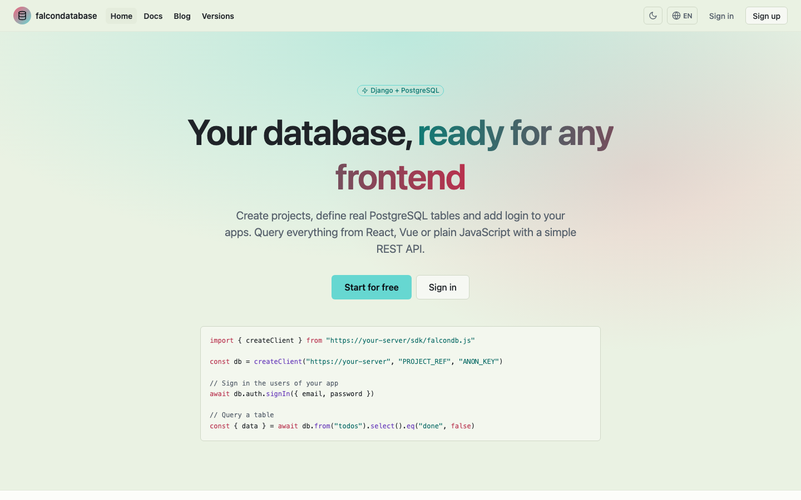
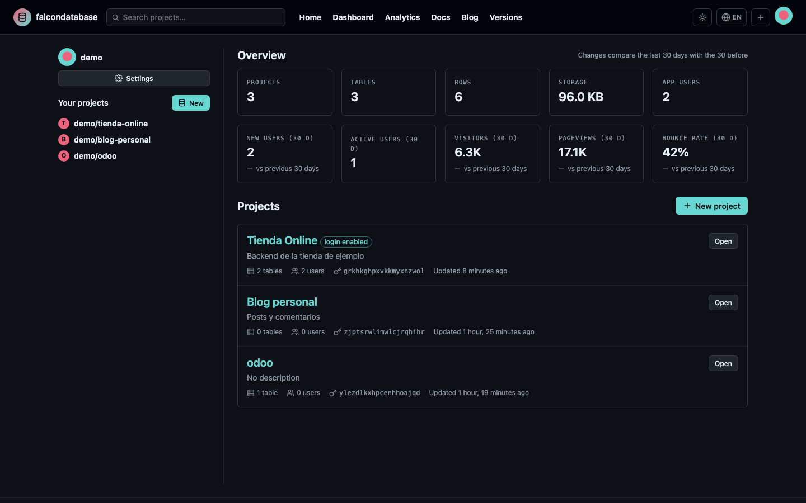
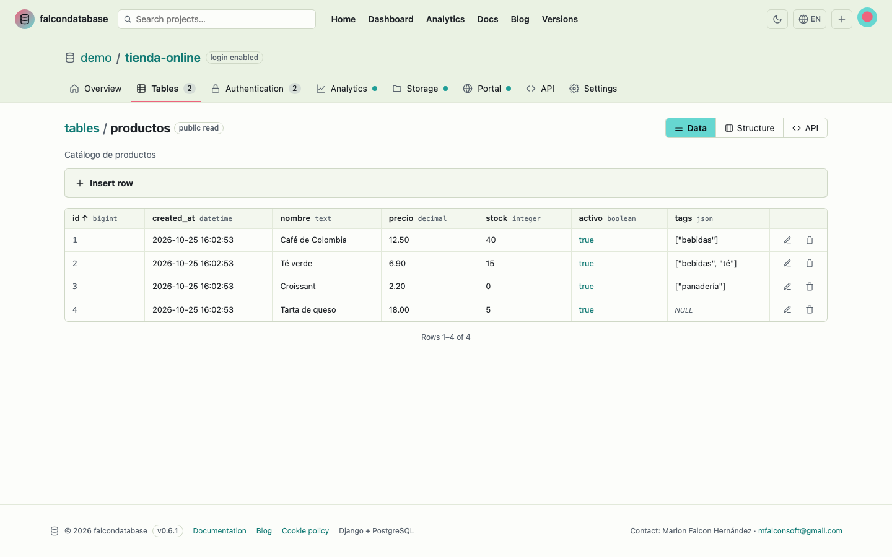
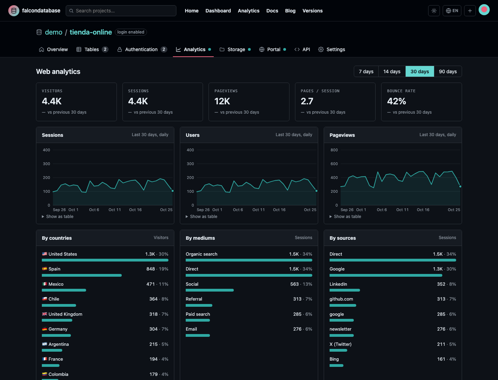
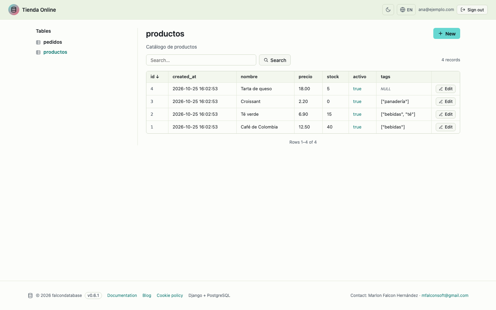
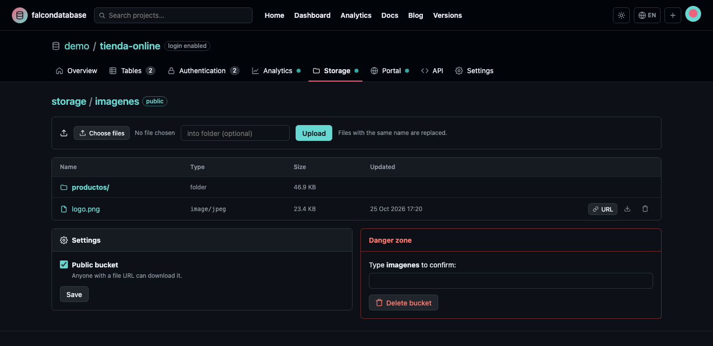
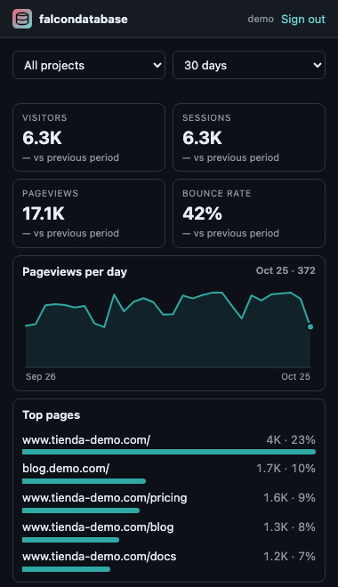

# falcondatabase

A simple, self-hosted alternative to Firebase and Supabase with a GitHub-style interface, built with **Django** and **PostgreSQL**.

<picture>
  <source media="(prefers-color-scheme: dark)" srcset="docs/screenshots/home-dark.png">
  
</picture>

Create projects, add real PostgreSQL tables and user login to them, and query everything from any frontend through a REST API or a tiny JavaScript SDK.

- **Install on a server:** `./install.sh` (Docker, step by step). See **[DEPLOY.md](DEPLOY.md)**.
- **Tutorials:** the built-in blog at `/blog/` has 17 articles in English and Spanish, with search, categories and topics.
- **What's new:** the release history is at `/changelog/` (current version **0.7.4**).

## Features

**Data and API**

- **Projects** at `/<username>/<project>/`, each with its own PostgreSQL schema (`proj_<ref>`), API URL and two keys: `anon` (browser) and `service` (server).
- **Real tables** with typed columns (`text`, `integer`, `bigint`, `decimal`, `float`, `boolean`, `date`, `datetime`, `json`, `uuid`), defaults (`now()`, `uuid()`), required and unique constraints.
- **Data editor**: insert, edit, delete, sort and paginate rows; add or remove columns.
- **REST API** with filters (`eq`, `gt`, `ilike`, `in`, `is`…), ordering, pagination and CORS.
- **JavaScript SDK** with no dependencies, served at `/sdk/falcondb.js`: tables, login and storage.
- **File storage**: public and private buckets per project, a file browser, uploads from your app and signed links that expire. A simple alternative to S3.
- **Export / import** a project as JSON (structure, optionally with data), on the same or another server.
- **Manage it with AI**: an MCP server at `/api/ai/mcp` lets Claude, Cursor or any assistant create and edit tables, columns, rows and app users. Connect it with a personal token, or in Claude as a custom connector with one click (OAuth).

**Apps and users**

- **Login for your apps**: email/password sign up and sign in per project, user management in the dashboard.
- **Access rules per table**: public, public read, signed-in users, owner (automatic `owner_id`) or private.
- **Portal**: turn a project into a standalone app at `/app/<username>/<address>/`, where its users view or edit the tables you choose with generated forms and search.

**Insights**

- **Web analytics** per project with one cookie-free `<script>` tag: sessions, users, pageviews, countries, mediums, sources, pages, devices and browsers. `/analytics/` combines all your projects or a selection.
- **Dashboard KPIs**: ten headline numbers (projects, tables, rows, storage, app users, new and active users, visitors, pageviews, bounce rate).
- **Contribution graph** of the last year, GitHub style, for all your projects or one, plus a recent activity list per project.
- **Uptime monitoring**: every website of a project is requested every 1–60 minutes; 90 days of history with uptime per day, response time charts and incidents, and an email or webhook (Slack, Discord…) when a site goes down and when it comes back. `/uptime/` shows every monitor.
- **Chrome extension** with your analytics and today's visits on its icon: download it from `/extension/` and follow the installation guide in the blog.

**Teams and accounts**

- **Sharing**: invite other accounts to a project by email, as **editor** or **viewer**.
- **Two-step authentication (TOTP)** with 8 single-use recovery codes, and a **profile picture**.
- **A single admin** who sees every user at `/users/`, creates accounts, resets passwords and 2FA, turns public sign up off and can measure the visits to the site itself.

**Site**

- **English and Spanish** interface, switchable from the header or the profile. API errors follow `Accept-Language`.
- **Light and dark mode**, following the system by default, with a validated color palette.
- **Home page** with an animated triangle mesh that opens around the mouse (static when the system asks for reduced motion).
- **Blog** with tutorials, guides and news in both languages, with **search**, **categories** and **topics**.
- **Versions page** (`/changelog/`). The current version is shown in the footer and returned by `/healthz`.
- **Cookie notice** and cookie policy (`/cookies/`): only essential and preference cookies.

## Screenshots

| | |
|---|---|
| **Dashboard**: key indicators and contribution graph<br> | **Data editor** of a table<br> |
| **Web analytics** of a project<br> | **Portal**: the project as a standalone app<br> |
| **Storage**: buckets and files<br> | **Chrome extension**<br> |

Screenshots are stored in `docs/screenshots/`.

## Quick start with Docker

### 1. Prepare the server and install Docker

On a fresh Ubuntu 22.04/24.04 or Debian 12 server:

```bash
# Update the system and open the firewall
sudo apt update && sudo apt full-upgrade -y
sudo apt install -y git curl ufw unattended-upgrades
sudo ufw allow OpenSSH && sudo ufw allow 80,443/tcp && sudo ufw enable

# Install Docker with the Compose plugin and start it on boot
curl -fsSL https://get.docker.com | sudo sh
sudo systemctl enable --now docker
sudo usermod -aG docker $USER        # log out and back in afterwards
docker compose version               # check it works
```

[DEPLOY.md](DEPLOY.md#prepare-the-server) explains every step, with the official apt repository install, a non-root user, automatic security updates and swap for small servers.

### 2. Install falcondatabase

```bash
git clone https://github.com/falconsoft3d/falcondatabase.git
cd falcondatabase
./install.sh
```

The installer checks the requirements, asks a few questions (domain, HTTPS, port, language, admin account), generates `.env` with random secrets, builds the image, starts PostgreSQL and the app, and creates your admin account.

### 3. Keep it up to date

Back up first ([how](DEPLOY.md#backups-and-restore)), then:

```bash
sudo apt update && sudo apt full-upgrade -y        # system and Docker
[ -f /var/run/reboot-required ] && sudo reboot     # falcondatabase starts again on its own
cd falcondatabase && git pull && ./install.sh      # new version, latest PostgreSQL/Caddy images
docker image prune -f                              # remove old images
```

To deploy automatically on every push to `main`, set up the GitHub Actions workflow: [DEPLOY.md](DEPLOY.md#automatic-deploy-on-every-push).

Your data and `.env` are kept. Step-by-step guide in Spanish: [docs/actualizar-servidor.md](docs/actualizar-servidor.md). [DEPLOY.md](DEPLOY.md#keeping-the-server-up-to-date) has the full routine, including major PostgreSQL upgrades, and also covers HTTPS, backups and troubleshooting.

## Local development

Requirements: Python 3.12+, PostgreSQL 14+ and GNU gettext (for translations).

```bash
python3 -m venv .venv
.venv/bin/pip install -r requirements.txt
cp .env.example .env                         # adjust the PostgreSQL settings

# Optional: a PostgreSQL server in Docker that matches .env.example
docker compose -f docker-compose.dev.yml up -d

.venv/bin/python manage.py migrate
.venv/bin/python manage.py compilemessages --ignore=.venv
.venv/bin/python manage.py runserver
```

Open http://localhost:8000, create an account, then make it the admin:

```bash
.venv/bin/python manage.py setadmin <username>
```

There is always exactly one admin: `setadmin` removes admin rights from everyone else.

To try the analytics charts without a real website, fill a project with sample visits:

```bash
.venv/bin/python manage.py seed_analytics <username>/<project-slug> --days 30
```

### Tests

The tests create a temporary PostgreSQL database:

```bash
.venv/bin/python manage.py test
```

### Translations

Interface strings are written in English and translated in `locale/es/LC_MESSAGES/django.po`. After changing texts:

```bash
.venv/bin/python manage.py makemessages -l es --no-wrap --ignore=.venv
# translate the new entries in locale/es/LC_MESSAGES/django.po, then:
.venv/bin/python manage.py compilemessages --ignore=.venv
```

### Release notes

Every change gets an entry in `core/changelog.py` (newest first, English and Spanish). The first entry sets the version shown in the footer, on `/changelog/` and in `/healthz`.

### Blog articles

Each article is two Markdown files in `blog/posts/`: `<slug>.en.md` and `<slug>.es.md`. They start with a small front matter block:

```markdown
---
title: "Tutorial: my new article"
date: 2026-11-01
category: tutorial          # tutorial, guide or news
summary: One sentence shown in the listing.
tags: api, javascript
---
Article body in Markdown. %BASE_URL% is replaced with the server URL.
```

New files show up automatically. A test checks that every article exists in both languages.

## Web analytics

1. Open a project → **Analytics** → check **Enable analytics** → **Save**.
2. Paste the snippet in the `<head>` of your website:

   ```html
   <script defer data-project="PROJECT_REF" src="https://your-server/a.js"></script>
   ```

The script (~1 KB) sends one page view per page load and per client-side navigation (React, Vue…). Privacy by design:

- No cookies or local storage.
- No IP addresses are stored. A visitor is an HMAC of (day, project, IP, user agent) that changes every day, so visitors are counted once per day.
- Sessions group page views less than 30 minutes apart. Source and medium come from UTM parameters or the referrer (direct, organic search, social, referral…).
- The country comes from a CDN header (`CF-IPCountry`) if present, otherwise from the browser time zone, otherwise from `Accept-Language`.
- Bots are ignored. You can restrict which domains may send data.

Behind a reverse proxy, set `FALCONDB_TRUST_PROXY=true` so the visitor IP is read from `X-Forwarded-For`. It defaults to the value of `USE_HTTPS`.

**Site analytics.** The admin can also measure visits to falcondatabase's own public pages (home, blog, docs, versions, sign in and sign up): **Users** → **Site analytics** → **Measure visits to this site**. This creates a project called "falcondatabase site" owned by the admin, whose charts appear in `/analytics/`. Dashboards and portals are never measured.

## Uptime monitoring

1. Open a project → **Uptime**, enter the website address and the interval (every 1, 5, 10, 15, 30 or 60 minutes) → **Add monitor**. If the project has analytics domains, **Monitor them** adds them all in one click (also from `/uptime/`).
2. The **uptime worker** requests each URL on schedule. Any answer below 400 counts as up; a failed request is retried once before it counts as down. With Docker it is the `uptime` service; in development run it in a second terminal:

   ```bash
   .venv/bin/python manage.py uptime_worker          # forever, looks for due monitors every 30 s
   .venv/bin/python manage.py uptime_worker --once   # one round (for cron)
   ```

3. When a site goes down an incident opens and, if **Email me** is checked, the project owner gets an email; another one arrives when it comes back. A **webhook** URL receives a JSON POST (`event`, `url`, `error`, `text`…) that Slack and Discord show as a message.

Emails need SMTP settings in `.env` (`EMAIL_HOST`, `EMAIL_PORT`, `EMAIL_HOST_USER`, `EMAIL_HOST_PASSWORD`, `DEFAULT_FROM_EMAIL`); without them they are written to the log. Private addresses (localhost, 10.x, 192.168.x…) are refused unless `FALCONDB_UPTIME_ALLOW_PRIVATE=true`. Checks older than 90 days are deleted (`FALCONDB_UPTIME_RETENTION_DAYS`).

## Portal

Open a project → **Portal**, check **Enable portal**, choose an address (e.g. `project1`) and decide, per table, **Hidden**, **View only** or **View and edit**. The app is then at:

```
https://your-server/app/<username>/project1/
```

- People sign in with the users of the project's **Authentication** tab (and can sign up if **Allow public sign up** is on).
- **Public portal**: anyone can view the "View only" tables without signing in. Creating, editing and deleting always require signing in.
- Tables with the **Owner** access rule only show each user their own rows, and new rows are assigned to them.
- The portal session is separate from dashboard accounts.

## File storage

Open a project → **Storage**, enable it and create buckets. In a **public** bucket every file has a direct URL; in a **private** bucket, files are served only with the service key, to the user who uploaded them, or through a **signed URL** that expires.

```js
const bucket = db.storage.from("avatars")
await bucket.upload("users/ana.png", file, { upsert: true })   // signed-in user or service key
const { data } = await bucket.list("users")
const url = bucket.getPublicUrl("users/ana.png")                // public buckets
const { data: link } = await bucket.createSignedUrl("users/ana.png", 3600)
await bucket.remove("users/ana.png")
```

| Method | Path | Action |
|---|---|---|
| GET | `/api/v1/<ref>/storage` | List buckets |
| GET | `/api/v1/<ref>/storage/<bucket>?prefix=` | List files |
| POST / PUT | `/api/v1/<ref>/storage/<bucket>/<path>` | Upload (multipart field `file`; PUT or `?upsert=true` replaces) |
| DELETE | `/api/v1/<ref>/storage/<bucket>/<path>` | Delete |
| POST | `/api/v1/<ref>/storage/sign/<bucket>/<path>` | Signed URL (`{"expires_in": seconds}`) |
| GET | `/storage/v1/<ref>/<bucket>/<path>` | Download (`?token=` for signed URLs, `?download=1` to force a download) |

Files are stored on disk under random names (the paths you choose are only metadata). They are served with `Content-Security-Policy: sandbox` and `nosniff`, and HTML/SVG/JS are always downloaded, never rendered. Limits: `FALCONDB_STORAGE_MAX_FILE_MB` per file and `FALCONDB_STORAGE_QUOTA_MB` per project.

## Sharing projects

In a project, go to **Settings** → **Members**, type the email of an existing account and choose a role:

| Role | Can do |
|---|---|
| **Editor** | Everything inside the project: tables, data, structure, app users, analytics, storage and portal settings |
| **Viewer** | Open every page and read the data, but change nothing (any change returns *403*) |
| **Owner** | Everything, plus Settings: rename, keys, export, members and deleting the project |

Shared projects appear under **Shared with you** on the dashboard and in `/analytics/`. Members can leave a project from its overview, and the owner can change their role or remove them at any time.

## Contributions and activity

Every change to a project is recorded: tables and columns, rows inserted, updated or deleted (from the dashboard, the API or the portal), files, buckets, members and app users. From that:

- the **dashboard** shows a GitHub-style graph of the last year for all your projects, with a picker to see just one;
- each project's **Overview** shows its own graph and a **Recent activity** list (who did what, and when).

Existing projects get their history rebuilt from the dates already stored when you run the migrations.

## Chrome extension

Open **`/extension/`** (also linked from the home page) and download the zip. It comes pre-configured for your server. Then:

1. Unzip it (you get a `falcondatabase-extension` folder).
2. Go to `chrome://extensions` and turn on **Developer mode**.
3. Click **Load unpacked** and pick the folder.
4. Click the icon and sign in with your username and password (and your 2FA code if enabled).

The popup shows visitors, sessions, pageviews and bounce rate with their change, a daily chart, and the top pages, sources and countries, for all your projects or one. The icon badge shows today's pageviews and refreshes every 30 minutes. The source is in `extension/` (Manifest V3, English and Spanish).

It uses the account API: `POST /api/account/token` (username, password, optional `code`) returns a 30-day token, revoked when the password changes; `GET /api/account/analytics?days=&p=<project ref>` returns the report.

## Manage it with AI

falcondatabase is an MCP server at `/api/ai/mcp` (the same tools also answer over plain HTTP at `/api/ai/tools/<tool>`). `/ai/` and the **AI** tab of each project have the connection guide already filled in.

- **Claude (claude.ai, Desktop, mobile)**: **Settings → Connectors → Add custom connector** and paste `https://your-server/api/ai/mcp`. Claude opens falcondatabase, you sign in (with 2FA if enabled), choose one project or all and read-only or read and write, and press **Authorize**. Claude's servers call yours, so it needs a public HTTPS address.
- **Claude Code**: `claude mcp add --transport http falcondatabase https://your-server/api/ai/mcp`, then `/mcp` → **Authenticate**. It also works against `http://localhost`.
- **Any other client**: create a token in **Settings → AI access** and send `Authorization: Bearer fdb_ai_…`.

The connector uses OAuth 2.1: discovery (`/.well-known/oauth-protected-resource`, `/.well-known/oauth-authorization-server`), dynamic client registration (`/oauth/register`), PKCE S256 (`/oauth/authorize`, `/oauth/token`) and revocation (`/oauth/revoke`). Each approval appears in **Settings → AI access** as a *connector* and is revoked there like any token. Access tokens last one hour and are renewed with a single-use refresh token valid for 90 days.

## Export and import

- **Export:** project → **Settings** → **Export structure** or **Export structure and data**. The JSON contains the project settings, every table with its columns, defaults, constraints, access rule and portal mode, the bucket definitions, and the rows if requested. App users and stored files are never exported.
- **Import:** **New project** → **Or import a project from JSON**. Everything is created in one transaction: if anything fails, nothing is created. Row ids are kept and new ids continue after them.

## Using it from a frontend

```js
import { createClient } from "https://your-server/sdk/falcondb.js"

const db = createClient("https://your-server", "PROJECT_REF", "ANON_KEY")

// Read with filters
const { data, count, error } = await db.from("products")
  .select("id,name,price")
  .gte("price", 10)
  .order("price", { desc: true })
  .limit(20)

// Write
await db.from("products").insert({ name: "Coffee", price: 2.5 })
await db.from("products").update(7, { price: 3 })
await db.from("products").delete(7)

// Sign in the users of your app
await db.auth.signUp({ email, password })
await db.auth.signIn({ email, password })
const { user } = await db.auth.getUser()
db.auth.signOut()
```

Without the SDK:

```bash
curl "https://your-server/api/v1/PROJECT_REF/tables/products?price=gte.10&order=price.desc" \
  -H "apikey: ANON_KEY"
```

### API endpoints

| Method | Path | Action |
|---|---|---|
| GET | `/api/v1/<ref>` | Visible tables and columns |
| GET | `/api/v1/<ref>/tables/<table>` | List rows → `{data, count}` |
| POST | `/api/v1/<ref>/tables/<table>` | Insert an object or a list (one transaction) |
| GET / PATCH / DELETE | `/api/v1/<ref>/tables/<table>/<id>` | One row |
| POST | `/api/v1/<ref>/auth/signup` | Sign up → `{user, token}` |
| POST | `/api/v1/<ref>/auth/login` | Sign in → `{user, token}` |
| GET / PATCH | `/api/v1/<ref>/auth/user` | Current user (requires the token) |

Headers: always `apikey: <anon or service key>`, plus `Authorization: Bearer <token>` to act as a signed-in user.
Filters: `column=operator.value` with `eq`, `neq`, `gt`, `gte`, `lt`, `lte`, `like`, `ilike`, `is` (`null`/`true`/`false`) and `in` (`in.(a,b)`). Also `select`, `order`, `limit` and `offset`.

### Access rules

| Rule | Read | Write |
|---|---|---|
| Public | anyone | anyone |
| Public read | anyone | signed-in users |
| Signed-in users | signed-in users | signed-in users |
| Owner | own rows only | own rows only (`owner_id` set automatically) |
| Private | service key | service key |

## Project structure

```
config/        settings and URLs
core/          home, docs, sign up/login, 2FA (totp.py), profile, admin users page, cookies, SDK view
  management/commands/   setadmin, ensureadmin
projects/      models (Project, ProjectTable, ProjectUser) and the dashboard
  schema.py      engine that creates and queries the real tables (psycopg.sql)
  services.py    operations that change models + DDL in one transaction
  transfer.py    JSON export / import
  kpis.py        dashboard indicators
  activity.py    activity log and the contribution graph
api/           REST API, keys/tokens, access rules and CORS
analytics/     web analytics: tracking (tracking.py), aggregations (stats.py), dashboards, seed_analytics
portal/        standalone per-project apps at /app/<username>/<address>/
extension/     Chrome extension (Manifest V3) for the account API
storage/       buckets and files (files.py), API, public/signed downloads, file browser
blog/          Markdown blog (posts/<slug>.<lang>.md)
locale/        Spanish translation (django.po)
templates/     GitHub-style pages
static/        CSS (light/dark tokens), dashboard JS, home mesh (mesh.js) and the SDK (falcondb.js)
docker/        entrypoint and Caddyfile
install.sh     step-by-step Docker installer
```

How it works:

- Each project's tables live in their own PostgreSQL schema. The metadata (name, access rule) is stored in `ProjectTable`, and columns are read straight from the PostgreSQL catalog.
- Table and column names are validated (`^[a-z_][a-z0-9_]{0,62}$`) and composed with `psycopg.sql.Identifier`. Values are always sent as query parameters.
- App user tokens are Django signatures (`django.core.signing`) bound to the project, with a configurable lifetime.
- Two-step authentication implements RFC 6238 (TOTP) with the standard library. The QR code is generated with `segno`.
- Charts are plain SVG drawn by `static/js/analytics.js` (no chart library). Their colors were validated for contrast and color-vision deficiency in both themes.

## Configuration

All settings are environment variables, read from `.env`.

| Variable | Default | Description |
|---|---|---|
| `SECRET_KEY` | `dev-insecure-change-me` | Django secret. The app refuses to start with the default when `DEBUG=false`. |
| `DEBUG` | `true` | Set `false` in production. |
| `ALLOWED_HOSTS` | `localhost,127.0.0.1` | Comma separated host names. |
| `CSRF_TRUSTED_ORIGINS` | – | e.g. `https://db.example.com` |
| `USE_HTTPS` | `false` | `true` behind an HTTPS proxy: secure cookies and `X-Forwarded-Proto`. |
| `POSTGRES_DB` / `USER` / `PASSWORD` / `HOST` / `PORT` | `falcondatabase` / – / – / `localhost` / `5432` | Database connection. |
| `FALCONDB_LANGUAGE` | `es` | Default interface language (`es` or `en`). |
| `FALCONDB_CORS_ORIGINS` | `*` | Origins allowed to call the API from a browser. |
| `FALCONDB_TOKEN_MAX_AGE` | `604800` | Lifetime of app user tokens (seconds). |
| `FALCONDB_MAX_PAGE_SIZE` | `1000` | Maximum rows per request. |
| `FALCONDB_TRUST_PROXY` | value of `USE_HTTPS` | Read the visitor IP for analytics from `X-Forwarded-For`. |
| `FALCONDB_STORAGE_ROOT` | `media/storage` | Where uploaded files are written. |
| `FALCONDB_STORAGE_MAX_FILE_MB` | `50` | Maximum size of one uploaded file. |
| `FALCONDB_STORAGE_QUOTA_MB` | `1024` | Maximum storage per project. |
| `FALCONDB_CONTACT_NAME` / `FALCONDB_CONTACT_EMAIL` | Marlon Falcon Hernández / mfalconsoft@gmail.com | Contact in the footer and cookie policy. |
| `LOG_LEVEL` | `INFO` | Log level (logs go to the console). |

Docker-only variables (`FALCONDB_PORT`, `FALCONDB_BIND`, `FALCONDB_DOMAIN`, `WEB_CONCURRENCY`) are described in [DEPLOY.md](DEPLOY.md).

## Color palette

| Color | Use |
|---|---|
| `#ED637D` | Brand, active tab, avatar |
| `#66D7D1` | Primary buttons and links. In light mode, link text uses `#117a74` for enough contrast. Chart marks use the validated steps `#1f9e97` (light) and `#2fa9a3` (dark). |
| `#FFF87F` | Notices and highlights |
| `#F4F1BB` | Informative messages in light mode |
| `#EAF2E3` | Header and surfaces in light mode |

Every color is a CSS variable in `static/css/app.css`, defined once per theme.

## Contact

Marlon Falcon Hernández — [mfalconsoft@gmail.com](mailto:mfalconsoft@gmail.com)
